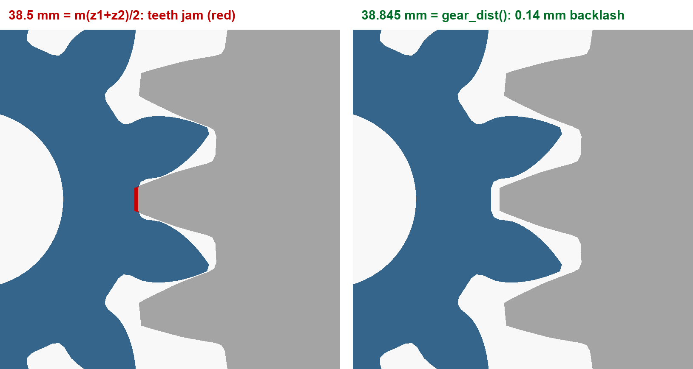
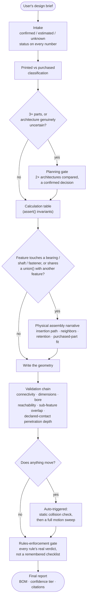

# openscad-cad-skills

[Claude Code](https://docs.anthropic.com/en/docs/claude-code) skills for parametric OpenSCAD
design, from a single part to a multi-part mechanical assembly. The model is checked
automatically before export: dimensions, holes, collisions, screws and full motion sweeps.

## What it catches



An 11-tooth pinion and a 66-tooth gear, module 1. The textbook centre distance is
m·(z1+z2)/2 = **38.5 mm**, and that is what this repository's own example used, with a
renders-fine, looks-fine model. But BOSL2 automatically profile-shifts small pinions, so the real
distance is **38.845 mm**. At 38.5 mm the printed gears jam (left, red). The check finds it before
anything is printed:

```text
$ bash validate_scad.sh --all
FAIL: gear axis / centre distance check (before any sweep runs):
  - centre distance pinion<->spur: axes are 38.500 mm apart (measured axes), BOSL2
    gear_dist(module 1.0, 11T/66T, profile shift auto, helical 0.0) = 38.845 mm (-0.345 mm).
CHECK_RESULT mechanics=FAIL
```

At 38.845 mm with the teeth phased to interleave, a 202-position motion sweep finds 0.139 mm of
backlash and no contact (right). This was a real bug in the example (fixed in P29, logged as
`INC-2026-11-27-01`); the example now runs in the regression suite so it cannot rot again.
Full example: [`scad-modeler/examples/gear_reduction/`](scad-modeler/examples/gear_reduction/).

A *skill* is a folder of instructions and scripts that Claude Code loads when a request matches
it. You ask in plain language ("design a wall bracket for a 40 mm pipe", "a 6:1 gearbox for
this motor"). The skill makes Claude plan, calculate, write the `.scad`, render it, and run the
checks below before it reports the part as done.

## Status

**Beta, used on real projects.** Developed since 2026-08 and used on enclosures, gearboxes,
racks, figurines and a large CNC machine frame. Every check exists because a real model passed
review and was still wrong; each such case is logged in [`INCIDENTS.json`](INCIDENTS.json) (~145 entries).

| Measure | Value |
|---|---|
| Regression suite (`scad-modeler/tests/run_all.sh`) | 120 tests: 119 fixtures + GenKit suite (golden parts, 40 mutants), all green; CI on every push |
| Planted-defect benchmark ([`bench/PIPELINE_BENCH_2026-11-01.md`](bench/PIPELINE_BENCH_2026-11-01.md)) | 35/35 defects caught by the named check, 0/9 false alarms on clean controls |
| Agent evaluation ([`bench/AGENT_EVAL_2026-11-01.md`](bench/AGENT_EVAL_2026-11-01.md)) | 15/15 tasks passed (n = 3 × 5) |
| Checkers | 26 `check_*.py` scripts + motion sweep, wired into one command (`validate_scad.sh`) and a 26-rule gate |

Known gaps (see [Limits](#limits)): strength only for heat-set insert holes and simple beams, no slicer gates, no measured PETG
tolerances yet, motion checking samples rather than proves. Planned work is tracked in
[`NEXT.md`](NEXT.md) (the maintainer's work queue and roadmap).

## Install

Requirements: macOS or Linux, [Claude Code](https://docs.anthropic.com/en/docs/claude-code),
`git`, OpenSCAD **2025 or newer with the Manifold backend** (macOS: `brew install --cask
openscad@snapshot`; the plain `openscad` cask is too old for `--backend=Manifold`; headless
Linux also needs `xvfb`), and [`uv`](https://docs.astral.sh/uv/) for the Python environment.

1. Install the skills **from GitHub**, as a Claude Code plugin (recommended). Inside Claude Code:

   ```
   /plugin marketplace add Altern92/openscad-cad-skills
   /plugin install openscad-cad-skills@openscad-cad-skills
   ```

   Restart Claude Code. The skills are then `openscad-cad-skills:openscad-cad`,
   `openscad-cad-skills:scad-modeler` and `openscad-cad-skills:openscad-organic`. To update, run
   `/plugin marketplace update openscad-cad-skills`, then `/plugin update openscad-cad-skills`.
   Every commit on `main` is a new version.

   Alternative, without the plugin system (also for other harnesses): `install.sh` installs exactly
   a commit on `origin/main` into `~/.claude/skills` and then runs the installed test suite:

   ```bash
   curl -fsSL https://raw.githubusercontent.com/Altern92/openscad-cad-skills/main/install.sh | bash
   # or from a clone:
   git clone https://github.com/Altern92/openscad-cad-skills.git && bash openscad-cad-skills/install.sh
   ```

   Use one route, not both: two copies of the same skill can drift apart.

2. Create the Python environment the checkers use (`~/.local/share/scad-modeler/venv`; found
   automatically, no activation needed). `SKILLS` is where the skill folders landed:

   ```bash
   SKILLS=$(ls -td ~/.claude/plugins/cache/openscad-cad-skills/openscad-cad-skills/*/ | head -1)  # plugin
   # SKILLS=~/.claude/skills                                                                   # install.sh
   bash "$SKILLS/scad-modeler/scripts/setup_env.sh"
   ```

3. Check what this machine can do:

   ```bash
   python3 "$SKILLS/scad-modeler/scripts/doctor.py"     # OpenSCAD, libraries, Python packages
   python3 "$SKILLS/scad-modeler/scripts/selftest.py"   # runs the whole chain on a known part
   ```

4. In Claude Code, describe the part. `openscad-cad` and `scad-modeler` load on matching
   requests (or call them by name, e.g. `/openscad-cad-skills:scad-modeler` for the plugin,
   `/scad-modeler` for `install.sh`).

Incidents you log with `incidents.py add` from a plugin install go to
`~/.local/share/scad-modeler/INCIDENTS.local.json` (override: `SCAD_INCIDENTS_LOCAL`), because each
plugin update installs into a new folder. `list` and `search` read both that file and the shipped one.

`install.sh [--manual-only] [--no-test] [--dev] [TARGET]`. `--manual-only` makes the two main
skills load only when called by name. A clone with uncommitted or unpushed changes is refused
(`--dev` overrides it, with a warning). Do not symlink or copy the skill folders by hand: a stale
second copy once overwrote newer code. To update, run the same command again. Other harnesses:
pass the skills folder as `TARGET` (e.g. `bash install.sh ~/.dsh/skills` for DeepSeek Harness).

If you use OpenSCAD libraries (BOSL2, NopSCADlib), pin them per project with `env_gate.py
--write-lock`: a BOSL2 update once moved a gear's anchor and the render still "succeeded".

## Skills

| Skill | For |
|-------|-----|
| `openscad-cad` | A single part: insert, bracket, cover, enclosure, Gridfinity bin. Writing, rendering, exporting, dimensional checks. |
| `scad-modeler` | Multi-part assemblies: gears, bearings, shafts, frames, machines. Adds calculations before geometry, centralized parameters and positions, collision, screw and motion checks, and the GenKit generator. |
| `openscad-organic` | Organic figurines: characters, creatures, miniatures. hull/skin/sweep techniques, FDM detail minimums, proportion and silhouette checks. |

`scad-modeler` builds on `openscad-cad` (render/export commands and tolerance data live there),
so install them together; the plugin and `install.sh` both do.

## GenKit: parts from parameters

For common shapes the agent does not hand-write OpenSCAD. It fills in a small JSON spec, and
`gen/emit_part.py` emits a `.scad` from tested kit modules, together with the declarations
(`EXPECTED_BBOX`, hole counts) that the checks need, derived from the same numbers:

```bash
cd ~/.claude/skills/scad-modeler
python3 gen/emit_part.py tests/genkit/fixtures/box.json -o /tmp/box.scad
bash scripts/validate_scad.sh /tmp/box.scad
```

Kinds: `plate`, `plate_with_holes`, `bracket_l`, `box`, `lid`, `boss`, `hole_pattern`,
`snap_hook`, and the composite `box_with_lid` (box, lid, `assembly.scad`, `joints.json`).
Anything else is `custom`: hand-written, with declarations required. Schema: `gen/schema.json`;
one example per kind in `tests/genkit/fixtures/`; design docs in [`docs/genkit/`](docs/genkit/).
On 10 real user briefs GenKit produced a correct part in one shot 8 times and refused honestly
twice (0 false "done").

## Running the checks by hand

Claude runs these for you. To run them yourself, from a project root with `parts/*.scad`:

```bash
bash ~/.claude/skills/scad-modeler/scripts/validate_scad.sh --all     # whole project
bash ~/.claude/skills/scad-modeler/scripts/validate_scad.sh part.scad # one file
```

The bundled example:

```bash
cd ~/.claude/skills/scad-modeler/examples/gear_reduction
bash ../../scripts/validate_scad.sh --all
```

Declaration files in the project root switch on the deeper checks: `joints.json` (contacts and
motion, with group drivers `"parts": [...]` and a `"static"` list), `fasteners.json` (every
screw, plus `mounts`), `bores.json`, `attachments.json`, `acceptance.json`. Templates:
`scad-modeler/templates/`. Parts built by a Python/trimesh script count too: export them to
`build/positioned/<name>.stl`.

## Why this exists

An LLM can write OpenSCAD code that renders cleanly and still be wrong in
ways a render never shows: a bore sealed behind unbored material, two
sub-features overlapping inside one part's `union()` (invisible, since
`union()` of two overlapping solids is still one valid watertight shell), a
gear pair that's fine at rest but collides 40° into its rotation. Every one
of those is a real, logged incident in [`INCIDENTS.json`](INCIDENTS.json), not a
hypothetical.

**The differentiator: this is the only agent skill setup we know of that
machine-verifies a *moving* assembly** — not just "does this part look
right," but "do these gears/hinge/slider actually clear each other through
the full range of motion," sampled and checked automatically, with the
static-collision precondition, the declared-contact range, and the sweep
itself all wired into one command.

## How `scad-modeler` works



## A check that did not run must not look like one that passed

Every check reports one of **five** outcomes, and each has a different next action:

| Outcome | Means | Next action |
|---|---|---|
| `PASS` / `FAIL` | ran; the answer is known | FAIL: fix the model |
| `not-applicable` | does not apply here (a declaration is absent) | add the declaration if it should apply |
| `inconclusive` | **ran and could not determine an answer** | fix the checker or its inputs — never read as success |
| `advisory` | ran, reports, does not gate | read it and judge |

Each run ends with a count, and the two non-success outcomes are called out separately:

```
COVERAGE: 6 passed, 3 failed, 7 not-applicable, 1 inconclusive, 1 advisory (18 checks reported).
  1 check(s) RAN AND COULD NOT DETERMINE an answer -- this is the one outcome that must never
  be read as success. Each one above says why.
  7 check(s) did not apply to this project -- each names the declaration or file it needs.
```

This is not decoration. Measured on 11 real projects, the previous two-valued model left
**10 of 18 checks silent in every single project** — 89 `CHECK_RESULT` lines became 198, and
0 of 11 runs carried a coverage count before, versus 11 of 11 now. A silent check is
indistinguishable from a passing one, from a failing one, and from one that does not exist.

In `scad-modeler` the rule gate adds a **COVER** report — which rules never had their
antecedent fire, and whether they were the majority (`PERVASIVE`). Formal verification pairs
every `assert` with a `cover` on its antecedent for the same reason: a property whose
trigger never fires is a verification gap, not a success.

## What these skills actually verify

`scad-modeler`'s validation chain, in the order it runs (see
`scad-modeler/references/validation_decision_tree.md` for the full decision
tree — which check applies to which situation):

| Tool | Catches |
|---|---|
| `assert()` in `params.scad` | design invariants — stops the render |
| `check_connectivity.py` | a part silently splitting into disconnected islands (mandatory, no declaration needed) |
| `check_dimensions.py` | overall envelope vs. a declared `EXPECTED_BBOX`, tolerance derived from `$fa`/`$fs`, not a flat percentage |
| `check_features.py` | a bore's actual flat-to-flat size — what a shaft binds on, which a bounding box can't see |
| `check_bore_reachability.py` | a bore that measures correctly at its seat but is sealed behind unbored material somewhere between the seat and the outside |
| `check_subfeature_overlap.py` | two sub-features overlapping inside one part's own `union()` — invisible to every other check |
| `check_collisions.py` | unintended interference, insufficient clearance, and declared contacts checked against real penetration depth (not volume — see below) and against touching in more than one disjoint region |
| `motion_sweep.py` | interference and clearance **through a full motion cycle**, not one static pose, with gear-tooth periodicity collapse and adaptive refinement near the tightest clearance |
| `check_topology.py` | sealed or missing through-holes: the mesh genus must equal a declared `EXPECTED_THROUGH_HOLES` |
| `check_fasteners.py` | every declared screw as a line through the positioned parts: head room under later panels, free shank, pilot, thread bite, crossing screws; `mounts` fails a part bolted to nothing |
| `check_joint_graph.py` | a part with no declared joint (screw, press fit, glue, magnet) to the rest of the assembly |
| `check_sensitivity.py` | a hard-coded constant: re-renders with a declared parameter ×1.5 and fails if nothing changed |
| `acceptance.py` | acceptance numbers (bbox, hole count) approved by the user and locked by sha256, so the agent cannot "fix" the declaration instead of the part |
| `check_scad_lint.py` | rounded standard constants (EIA 44.45 mm) and computed dimensions with silent defaults |
| `check_proportions.py` / `check_silhouette.py` | `openscad-organic`: proportions against a source table, silhouette IoU against a reference image |
| `check_intake.py` / `check_plan.py` / `check_assumptions.py` / `check_service_envelope.py` | the requirements spec, the architecture decision, unresolved critical assumptions, and service-envelope completeness — the failure categories that don't show up in geometry at all |
| `check_dependencies.py` | which downstream parameters/parts a given edit actually affects, so a one-parameter change doesn't require blind faith in a full re-render |
| `check_rules.py` | runs the whole rules manifest and requires its output be cited before a final report — see `references/rules_enforcement.md` for why prompts alone don't hold up under context load |

A declared contact (a press fit, a gear mesh) is checked by **penetration
depth in mm** — the standard quantity for this in contact mechanics and
robotics — not by boolean-intersection volume, which can't be compared to a
linear mm spec without knowing contact area. A pair within its declared
depth range is *also* required to touch in exactly one contiguous region by
default, since a max-over-all-contact-points depth can't otherwise
distinguish one legitimate contact zone from that zone plus a separate,
unrelated structural collision hiding behind the same range — both were
real, confirmed gaps, not hypothetical (`INCIDENTS.json`, 2026-08-19).

## Stop gate (Claude Code, optional)

`scad-modeler/hooks/scad_stop_gate.py` refuses to let a Claude Code session end
while a `.scad` file it edited has not been through `validate_scad.sh` in its
current form (it compares sha256 against `build/.validation_state.json`). A FAIL
verdict does not block; it blocks at most once per stop. Add to `~/.claude/settings.json`:

```json
"hooks": {"Stop": [{"hooks": [{"type": "command",
  "command": "python3 /path/to/scad-modeler/hooks/scad_stop_gate.py", "timeout": 10}]}]}
```

`SCAD_STOP_GATE=0` turns it off for one session.

## Repository layout

| Path | What |
|---|---|
| `openscad-cad/`, `scad-modeler/`, `openscad-organic/` | the three skills (`SKILL.md` + `references/` + scripts) |
| `scad-modeler/scripts/` | checkers, `validate_scad.sh`, `doctor.py`, `selftest.py`, `setup_env.sh` |
| `scad-modeler/kit/`, `scad-modeler/gen/` | GenKit modules and generator |
| `scad-modeler/tests/` | regression suite: `fixtures/` (one real incident each), `genkit/`, `mutants.tsv` |
| `INCIDENTS.json` | every logged failure: symptom, root cause, fix, and the check that now catches it |
| `bench/` | planted-defect benchmark and agent evaluation |
| `docs/superpowers/specs/` | acceptance criteria for each change |
| `.claude-plugin/` | plugin manifest and its one-plugin marketplace (`/plugin marketplace add`) |
| `install.sh` | the GitHub installer without the plugin system |
| `NEXT.md` | maintainer's work queue and roadmap (history in `docs/archive/`) |

## Development

```bash
bash scad-modeler/tests/run_all.sh   # 120 tests, a few minutes
bash scripts/test_install.sh         # installer guard
bash scripts/test_plugin.sh          # plugin install from a local marketplace (needs the claude CLI)
```

Each fixture is a self-contained `run_test.sh` that reproduces a real incident and asserts the
real outcome, including failures. `tests/mutants.tsv` names, for every checker, a fixture that
must fail when that checker is replaced by `exit 0`: a checker never observed failing is
indistinguishable from one that does not work. Changes go through written acceptance criteria
(`docs/superpowers/specs/`), are pushed to `main`, and are then installed from GitHub (plugin or `install.sh`).

## Limits

Confidence tiers are documented in
`openscad-cad/references/confidence-tiers.md`. These skills aim for **Tier
5** — a motion-verified assembly.

Motion checking is **sampling, not proof**: nothing is checked between two
sampled positions. Adaptive refinement catches narrow clashes near the
tightest point, but a narrow clash far from that minimum can still slip
through. State the tier you're relying on.

Not implemented at all:

- **assembly-sequence verification** — a mechanism can pass every check here
  and still be physically un-buildable (see `SKILL.md` §0.6's belt-drive
  incident);
- **general load/strength analysis** — `check_strength.py` covers heat-set
  insert holes and simple beam bending from a declared `loads.json`; anything
  beyond that (FEA, fatigue, layer adhesion) is not modelled, and printed parts
  are anisotropic in a way generic values don't capture;
- **slicer printability gates** — no mainstream slicer documents
  thin-wall/non-manifold warnings as reachable through a CLI.

Tier 3 and above need a calibration profile: your printer and material's
actual measured deviation. Without one, geometry can be promised, but fit
cannot.

## License

MIT — see [`LICENSE`](LICENSE).
